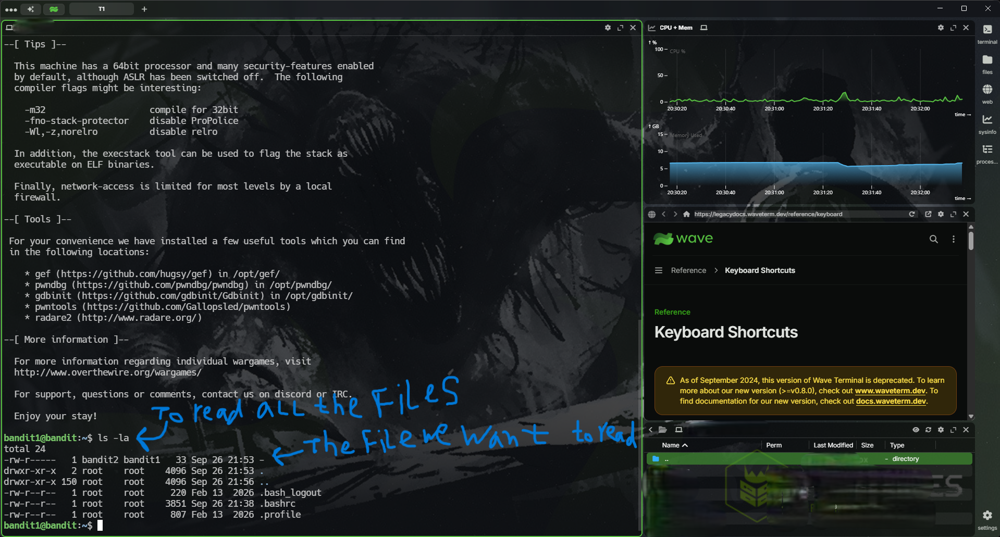
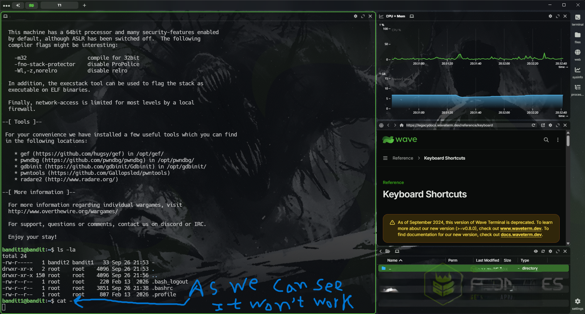
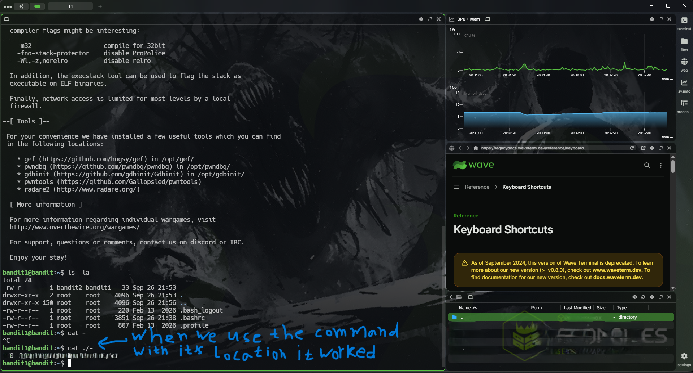

# Objective

This level introduces basic Linux file navigation and file-reading commands. The goal is to locate the **`-`** file in the current directory and use `cat` to read its contents and obtain the password for the next level.

# Approach

start an encrypted connection using #ssh by specifying the user (**<span style="color:lightgreen; font-size: 20px">bandit1</span>**) password (**<span style="color:lightgreen; font-size:20px;">obtained from the last level readme file</span>**) to the domain name **<span style="color:lightblue;">bandit.labs.overthewire.org</span>** with port number **<span style="color:lightblue;">2220</span>** 
# Commands Used

**`~`** means a new step or command not  a part of the command itself you shouldn't write it every with every new command

``` bash
	~ ssh <user_name>@<domain_name> -p <port_number>
	~ <type_the_password> # for the user you have obtained from the last level
	~ cd
	~ ls -la
	~ cat <file_to_Read> #(the Readme file which containg the password for the 
						 #next level)
```

``` bash
	~ ssh bandit1@bandit.labs.overthewire.org -p 2220
	~ <password_from_the_last_level>
	~ cd # or cd $HOME
	~ ls -la # to read all the current directory contents even the hiden one and                  data about each one
	~ cat ./- #the trick here is the file name
```

# Explanation

#### ssh --> used to establish a remote connection using the ssh protocol running on port 22

#### <user_name>@<domain_name> --> specifying the exact user we want to log in exactly on what device and we can use a domain name or an ip both will work with no problems

#### yes --> when we try to connect to a remote machine the first time we do it the machine will ask us if we trust to make a connection with the other device

#### \<password> --> if we chose yes then it prompt us to type a password of the user we try to connect to

#### cd --> cd is used to change the directory we are in when we type it alone it change the directory to the home directory of the user by default however in this level we don't have to use it because we start our session in the home of the user by default
#### cat <file_name> (./-) --> to read the contents of the **<span style="color:cyan">-</span>** file to get the password for the next level but there is a problem which is the filename ( - ) because it can trick the cat command because it can see it as a start of a flag so we write it with it's location in the directory tree to specify it's a file in the directory tree

# Key Concepts

- **SSH (Secure Shell):** An encrypted protocol used to connect to remote machines. The command `ssh <username>@<hostname> -p <port>` specifies the account, host, and port.
    
- **Linux File Paths:** `./` refers to the current directory. Using `./-` specifies a file named `-` and prevents it from being interpreted as a command-line option.
    
- **Reading Files with** **`cat`**: The command `cat <filename>` displays a file's contents in the terminal, allowing us to retrieve the password for the next Bandit level.
# lessons learned

- Always check the current working directory and identify the correct file before reading it.
    
- Special filenames, such as `-`, may be interpreted as command-line options; use `./-` to reference the file explicitly.
    
- Each Bandit level builds practical Linux command-line skills, and the password obtained from one level is used to access the next.
# Screenshots






