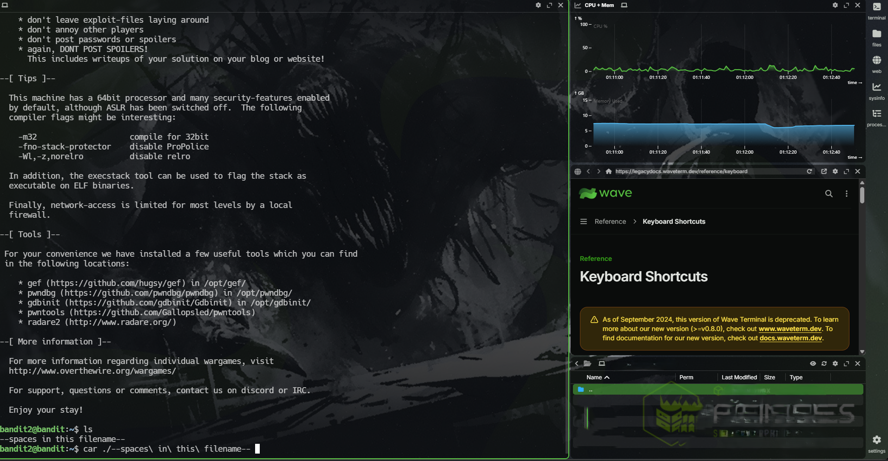
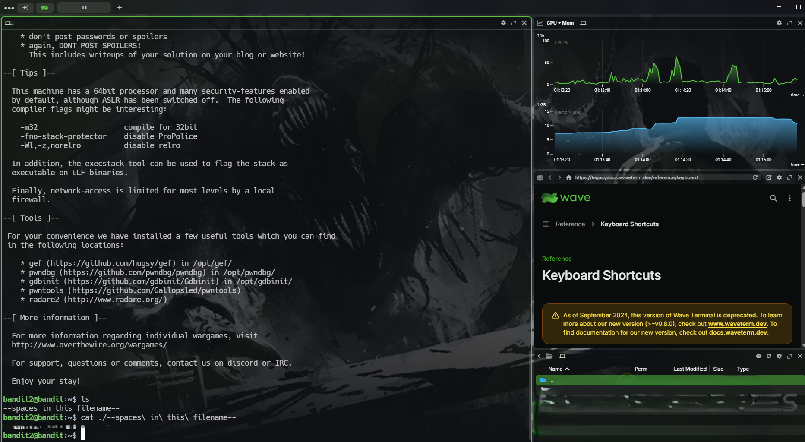

# Objective
This level introduces basic Linux file navigation and file-reading commands. The goal is to locate the **`--spaces in this filename--`** file in the current directory and use `cat` to read its contents and obtain the password for the next level.

# Approach

start an encrypted connection using #ssh by specifying the user (**<span style="color:lightgreen; font-size: 20px">bandit2</span>**) password (**<span style="color:lightgreen; font-size:20px;">obtained from the last level readme file</span>**) to the domain name **<span style="color:lightblue;">bandit.labs.overthewire.org</span>** with port number **<span style="color:lightblue;">2220</span>**

# Commands Used

**`~`** means a new step or command not  a part of the command itself you shouldn't write it every with every new command

``` bash
	~ ssh <user_name>@<domain_name> -p <port_number>
	~ <type_the_password> # for the user you have obtained from the last level
	~ cd
	~ ls -la
	~ cat <file_to_Read> #(the Readme file which containg the password for the 
						 #next level)
```

``` bash
	~ ssh bandit2@bandit.labs.overthewire.org -p 2220
	~ <password_from_the_last_level>
	~ cd # or cd $HOME
	~ ls -la # to read all the current directory contents even the hiden one and                  data about each one
	~ cat ./--spaces\ in\ this\ filename-- #the trick here is the file name                  contains spaces so we use the escape chat \ to escape the part after it            from being interpreted as a part of the command
```

# Explanation

#### ssh --> used to establish a remote connection using the ssh protocol running on port 22 by default how ever our target is running on 2220 we use the `-p` parameter to use the ssh with the new port

#### <user_name>@<domain_name> --> specifying the exact user we want to log in exactly on what device and we can use a domain name or an ip both will work with no problems

#### yes --> when we try to connect to a remote machine the first time we do it the machine will ask us if we trust to make a connection with the other device

#### \<password> --> if we chose yes then it prompt us to type a password of the user we try to connect to

#### cd --> cd is used to change the directory we are in when we type it alone it change the directory to the home directory of the user by default however in this level we don't have to use it because we start our session in the home of the user by default
#### cat <file_name> (./--spaces\ in\ this\ filename--) --> to read the contents of the **<span style="color:cyan">--spaces in this filename--</span>** file to get the password for the next level but there is a problem which is the filename ( --spaces in this filename-- ) because it can trick the cat command because it can see it as a start of a flag and there is a spaces in the file name we solve this by adding the (./) part in the beginning of the command to tell cat it's a file name by giving it the location of the file and we add the (<span style="color:green"> \ </span>) it's called the escape character it's used to escape the parts you don't want the program to interpret something you use it when you want to pass it as a normal string

# Key Concepts

- **SSH (Secure Shell):** An encrypted protocol used to connect to remote machines. The command `ssh <username>@<hostname> -p <port>` specifies the account, host, and port.
    
- **Linux File Paths:** `./` refers to the current directory Using `./--spaces\ in\ this\ filename--` specifies a file named `--spaces\ in\ this\ filename--` and prevents it from being interpreted as a command-line option.
	
- **Linux Escape character:** `\` used to escape the next character to prevent linux from interpret it as a part from the command Using
    
- **Reading Files with** **`cat`**: The command `cat <filename>` displays a file's contents in the terminal, allowing us to retrieve the password for the next Bandit level.

# Lessons Learned

- **Handling Spaces in Filenames:** Use the backslash (`\`) to escape spaces in filenames so Bash treats the filename as a single argument.
    
- **Referencing Special Filenames:** Use `./` to reference files in the current directory, especially when filenames begin with hyphens (`-`), to prevent them from being interpreted as command-line options.
    
- **Retrieving Passwords:** Use `cat` to read the contents of a file and obtain the password required to access the next Bandit level.

# Screenshot



