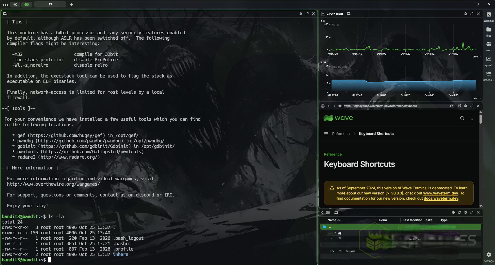
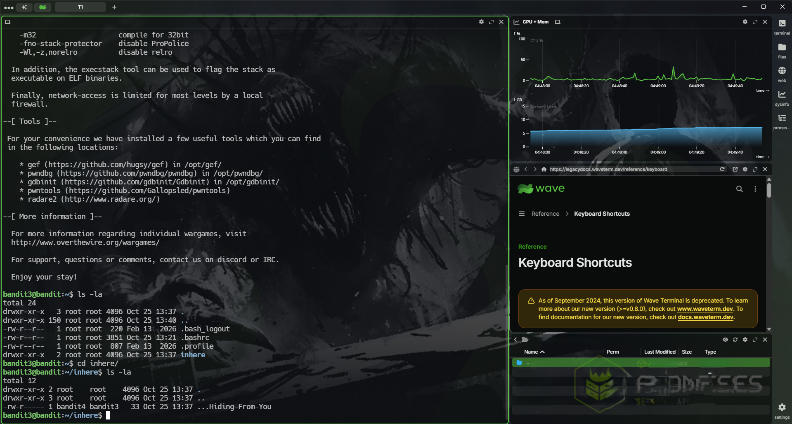
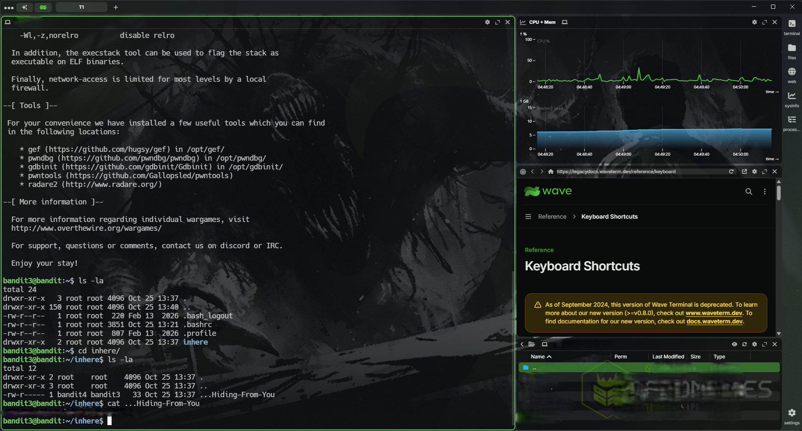

# Objective

This level introduces basic Linux file navigation and file-reading commands. The goal is to locate **`...Hiding-From-You`** the hidden file in the **inhere** directory and use `cat` to read its contents and obtain the password for the next level.

# Approach

start an encrypted connection using #ssh by specifying the user (**<span style="color:lightgreen; font-size: 20px">bandit3</span>**) password (**<span style="color:lightgreen; font-size:20px;">obtained from the last level readme file</span>**) to the domain name **<span style="color:lightblue;">bandit.labs.overthewire.org</span>** with port number **<span style="color:lightblue;">2220</span>** then read the **<span style="color:cyan">...Hiding-From-You</span>** file using the <span style="color:yellow">cat</span> command after going to the **<span style="color:#CBA6F7">inhere</span>** directory and list all the directory content even the hidden one using **<span style="color:yellow"> ls -la </span>**

# Commands Used

**`~`** means a new step or command not  a part of the command itself you shouldn't write it every with every new command

``` bash
	~ ssh <user_name>@<domain_name> -p <port_number>
	~ <type_the_password> # for the user you have obtained from the last level
	~ ls
	~ cd <directory_name> # to change directory to the directory of the file to                                read
	~ ls -la # to read all the contents even the hidden one's and display all data
	~ cat <file_to_Read> #(the Readme file which containg the password for the 
						 #next level)
```

``` bash
	~ ssh bandit3@bandit.labs.overthewire.org -p 2220
	~ <password_from_the_last_level>
	~ ls # to list the contents of the directory
	~ cd ./inhere
	~ ls -la # to read all the current directory contents even the hidden one and                  data about each one
	~ cat ./...Hiding-From-You 
```

# Explanation

#### ssh --> used to establish a remote connection using the ssh protocol running on port 22 by default however our target is running on 2220 we use the `-p` parameter to use the ssh with the new port

#### <user_name>@<domain_name> --> specifying the exact user we want to log in exactly on what device and we can use a domain name or an ip both will work with no problems

#### \<password> --> After establishing the SSH connection, the client prompts us to enter the password associated with the specified user.

#### ls --> ls is used to list the contents of the current directory and by using it we will find a directory called **<span style="color:#CBA6F7">inhere</span>** 

#### cd <directory_name> (inhere) --> to change the current directory to the **<span style="color:#CBA6F7">inhere</span>** directory

#### ls -la --> to list all the current directory folders and files even the hidden ones and display data about the file or directory like who is the owner and the group owner of the file and what is the privileges and functionalities the user can do to it like read ,write and execute
#### cat <file_name> (./...Hiding-From-You) --> to read the contents of the **<span style="color:cyan">...Hiding-From-You</span>** file to get the password for the next level but the file will be hidden because in linux every file or directory that start with a dot (.) is a hidden directory so we use <span style="color:yellow">ls -la</span> to list the content of the directory we are in

# Key Concepts

- **SSH & Custom Ports:** Connect to a remote server securely using SSH and specify a non-default port with `-p`.
	
- **Linux Directory Navigation:** Use `ls` to list directory contents and `cd` to change the current working directory.
	
- **Hidden Files & Permissions:** Use `ls -la` to display hidden entries and detailed information, including file permissions and ownership.
	
- **File Reading:** Use `cat` to read a file's contents and retrieve the password for the next level.

# Lessons Learned

- **Explore Before Reading:** List directory contents before accessing files to understand where the target file is located.
	
- **Identify Hidden Files:** Use `ls -la` to reveal entries whose names begin with a dot (`.`).
	
- **Understand Command Purposes:** Use `cd` to navigate, `ls -la` to inspect directory contents, and `cat` to read file contents.

# Screenshot





